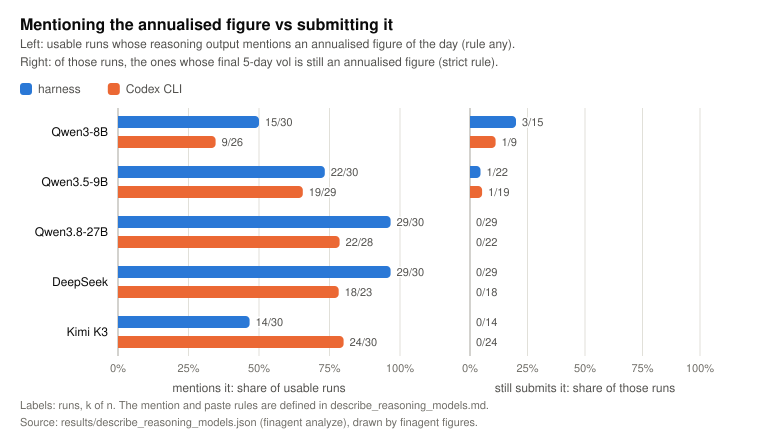
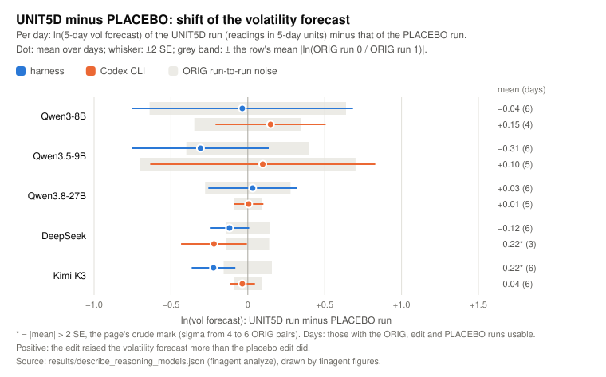

# The presentation pilot

**Does rewriting how the same price readings are presented change an LLM trading agent's 5-day
forecasts?** This repository holds a small exploratory pilot (300 runs: 5 reasoning models × 2 agent
frameworks × 6 days × 5 runs) with every input, every run record, and the code to verify, recompute
and rerun it.

Each day, an agent trading one US stock is shown seven price-tool readings: trend, RSI, mean reversion,
MACD, price statistics, support and resistance, and volatility. The information stays fixed; only its
presentation changes. NOLABEL removes the categorical labels, UNIT5D gives the annualised volatilities
as 5-day equivalents, and PLACEBO only reorders the keys, which controls for any change of text. The agent
then submits a 5-day return forecast and a 5-day volatility forecast (one standard deviation, in percent).
The pilot asks two things. Do the edits move these forecasts by more than the run-to-run noise? Does the
answer depend on the model, and on the framework: our 32-tool function-calling harness, or Codex CLI
working on files in a point-in-time folder?

## Design at a glance

| | |
|---|---|
| Models | 5 whose reasoning is visible ([PROTOCOL § Models](docs/PROTOCOL.md#models)): Qwen3-8B, Qwen3.5-9B, Qwen3.8-27B-FP8 (local, vLLM 0.29.0); DeepSeek (`deepseek-reasoner`, which the API reported as `deepseek-flash`); Kimi K3 (`kimi-k3`) |
| Frameworks | **harness**: 32 point-in-time tools, at most 10 turns, decision via `submit_decision`. **Codex CLI 0.162.1**: `prices.csv`, `news.csv`, `account.json` and `task.md` in a sandboxed folder, decision via `decision.json` |
| Days | 6, drawn with seed 20261018 from 250 candidates. 3 big-move days (\|z\| ≥ 2): MCHP 2026-08-07, HOOD 2026-04-14, CRWD 2026-08-27. 3 ordinary days (\|z\| < 1): VST 2026-05-06, CB 2026-04-22, MRK 2026-05-07 |
| Arms | ORIG (the same readings twice, as a noise pair), NOLABEL, UNIT5D, PLACEBO: 5 runs per day |
| Runs | 5 × 2 × 6 × 5 = 300. 286 are usable: 4 have an invalid decision, and the leakage audit flagged 10 coding-agent runs |
| Outcomes | `expected_vol_pct` and `expected_return_pct`; the shift against ORIG and against PLACEBO; annualised figures pasted as the 5-day vol; accuracy against the realised 5-day vol |

The full design is in [docs/PROTOCOL.md](docs/PROTOCOL.md) and the tools are in [docs/TOOLS.md](docs/TOOLS.md).

## Key findings

This is an exploratory pilot: 6 days, with one run per edit arm per day. **None of these findings is a test.**
The numbers come from [`results/describe_reasoning_models.json`](results/describe_reasoning_models.json). The tables, the
excerpts and the exact rules are on the [results page](results/describe_reasoning_models.md).

<!-- Sources, all in results/describe_reasoning_models.json unless noted (cells summed over the two frameworks):
 1 pasted_annualised_{strict,broad}_share x runs_usable
 2 reasoning_mentions_annualised_any_share, among_mention_any_submits_annualised_{strict,broad}_share
 3 reasoning_mentions_annualised_any_share_UNIT5D, harness_called_get_risk_budget_share
 4 shift_{NOLABEL,UNIT5D}_minus_PLACEBO_{lnvol,return_pp}[_outside_noise]; "6 of 6 days" from describe_reasoning_models.md note 4
 5 orig_run_to_run_abs_diff_lnvol
 6 mean_abs_ln_vol_forecast_over_realised5d, _bias, mean_abs_ln_vol_err_se_over_days; baselines in results/describe.json
 7 mean_tool_calls_or_commands_finished, computed_vol_from_prices_csv_share -->

- **Only the two small Qwen models ever submit an annualised figure as the 5-day volatility.** They do so in
  9 of their 115 usable runs under the strict rule (between 0.9 × the lowest and 1.1 × the highest of the
  day's four annualised readings), and in 12 under the broad rule (closer in log to the annual scale than
  to the 5-day scale; [PROTOCOL § Measures](docs/PROTOCOL.md#measures)). Qwen3.8-27B, DeepSeek and Kimi K3
  never do: 0 of 171 runs, in both frameworks.
- **Every model notices the annualised readings. The three larger models never submit one; the small Qwens
  still do in about 1 in 10 of the runs that mention one.** The reasoning of the three larger models
  mentions an annualised figure in 136 of 171 runs, and none of those runs submits it ("45% × sqrt(5/252)
  ≈ 6.35%"). The small Qwens mention one in 65 of 115 runs, and 6 of those 65 still submit it (8 under
  the broad rule).
- **UNIT5D removes the annual number only where the readings are its only source.** No Codex UNIT5D run
  mentions one (0 of 28). In the harness, DeepSeek (6 of 6 UNIT5D runs), Qwen3.8-27B (5 of 6) and Kimi K3
  (1 of 6) still do. These models call `get_risk_budget` (in 29, 28 and 16 of 30 runs). That tool
  reports the 20-day volatility in annual units, and no arm rewrites it.
- **Compared with PLACEBO, most shifts are within noise.** Of the 40 edit-minus-PLACEBO comparisons
  (10 cells × 2 edits × volatility and return), 6 pass the page's crude 2 SE mark; for volatility alone
  it is 4 of 20. Two marks are at or below zero on all 6 days, both for Kimi K3 and UNIT5D: −0.22 in
  ln(vol) in the harness, and −0.75 pp in the return forecast in Codex. The others rest on a single day, on only 3 days,
  or on pasted annual figures (the page's note 4).
- **Noise decides what can be seen.** The ORIG pair differs in ln(vol) by 0.09 for Kimi K3 / Codex and
  Qwen3.8-27B / Codex, 0.14 to 0.16 for DeepSeek and Kimi K3 / harness, 0.28 for Qwen3.8-27B / harness,
  and 0.35 to 0.70 for the small Qwens. A shift of about 0.1 can show only in the quietest cells.
- **The three larger models are about as accurate as two forecasts that need no agent.** Their mean error
  |ln(forecast / realised 5-day vol)| is 0.39 to 0.41 in both frameworks, slightly lower than that of the
  readings' 20-day vol in 5-day units (0.48) and of the S1 prior, the day's prior 5-day sd from the
  registered rational model (0.43). Every gap is smaller than the cell's SE over days (0.08 to 0.15), so
  neither the six cells nor the cells and the baselines can be told apart. The small Qwens are at 0.54 to
  0.67. Every cell's forecasts are too high on average.
- **The framework changes how much work a model does.** Harness tool calls per run: DeepSeek 12.1,
  Qwen3.8-27B 9.1, Kimi K3 3.7, and about 1 for the small Qwens. Codex runs that computed a volatility
  from `prices.csv`: DeepSeek 23/23, Qwen3.5-9B 25/29, Qwen3.8-27B 23/28, Kimi K3 19/30, Qwen3-8B 0/26.



*The reasoning mentions an annualised figure (left), and among those runs, the final 5-day vol is still
that figure (right, strict rule).*



*UNIT5D minus PLACEBO in ln(5-day vol forecast): the mean over days with ±2 SE, against the cell's ORIG
run-to-run noise (grey band). [`results/README.md`](results/README.md) explains every output, along with the other
three charts.*

## Reproduce

| Level | What it shows | Needs | Time (CPU) |
|---|---|---|---|
| **L0** | every input byte, prompt, tool schema and tool output is the one the pilot used | this repository | ~15 s |
| **L1** | every record and every reported number follows from the shipped run logs | the records unpacked (436 MB) | ~10 s + ~12 s |
| **L2** | the leakage audit of the 150 coding-agent runs gives the same verdicts | the records unpacked | ~6 s |
| **L3** | any model × framework cell can be rerun with the same protocol | Linux ≥ 6.7, a GPU or API keys, Codex 0.162.1 | minutes to an hour per cell |

Set up once, from the repository root, with Python 3.12. The install must be editable (`-e`), because
the code finds `data/` and `records/` relative to the checkout:

```sh
python3.12 -m venv .venv && source .venv/bin/activate
pip install -r setup/requirements/runner.txt -e ".[test]"     # or: make setup
```

```sh
finagent verify --level L0    # 10 of 10 checks passed (L0)
finagent unpack               # 4443 of 4443 files in records/raw match records/MEMBERS.sha256
finagent verify --level L1    # 11 of 11 checks passed (L1)
finagent verify --level L2    # 2 of 2 checks passed (L2)
```

`make verify` runs all of this in one go: it unpacks the records first if needed and prints
`23 of 23 checks passed (L0, L1, L2)` in about 30 s on the original host (2 × Xeon Platinum 8352V).
`finagent analyze --check` reports `same` for each of the 6 files in `results/`, and `finagent audit`
reports `150 of 150 verdicts identical`. [REPRODUCING](docs/REPRODUCING.md) explains every check, and
`make test` runs them as tests, with the golden-fixture unit tests.

**L3, new runs.** Set up the host (sandbox, Codex 0.162.1, the agent's Python, vLLM and weights, or API keys)
following [docs/REPRODUCING.md](docs/REPRODUCING.md). Then run one cell:

```sh
export FINAGENT_HOST_ENV=$HOME/finagent-host.env     # your copy of setup/host.example.env
finagent run --model kimi --framework harness --dry-run   # writes the 30 runs' inputs and checks the host
finagent run --model kimi --framework harness             # 30 runs into runs/pilot/raw, resumable
finagent analyze --raw runs/pilot/raw --out runs/pilot/results   # the pilot's measures for the new cell
```

A rerun follows the same protocol, but its outputs are not byte-identical: sampling, API model versions
and Codex's host-dependent prompt text all differ. [REPRODUCING § Expected differences](docs/REPRODUCING.md#expected-differences)
lists each source of difference.

## Repository map

```
.
├── README.md, README.zh-CN.md   this overview, in English and Chinese
├── LICENSE                      MIT, for the code
├── DATA_LICENSE.md              CC BY 4.0 for our records and data; the terms of third-party material and the news notice
├── pyproject.toml, Makefile     the `finagent` package; make setup | unpack | verify | analyze | audit | prompts | figures | test | clean
├── setup/
│   ├── experiment.toml          design constants: days, arms, runs per arm, seeds, turn limit, tool-result cut, wall cap, concurrency
│   ├── models.toml              one table per model: ids, endpoint, harness request, Codex settings, vLLM flags, weights revision
│   ├── host.example.env         host settings for new runs: paths, ports, GPU
│   ├── host.recorded.env        the original host's values, used to re-audit the shipped records
│   ├── weights/                 sha256 of every weight, config and tokenizer file of the three local models
│   ├── requirements/            pinned package lists: runner.txt, agent-env.txt, vllm.txt
│   └── scripts/                 host setup for new runs: runner, agent env, Codex 0.162.1, vLLM env, weights
├── data/                        every input, byte-identical: days, price panel, point-in-time caches (96 tickers), anchors, selection files
│   ├── prompts/                 every text the models saw, written by `finagent prompts` (72 files)
│   └── evidence_relations/      CPU-only extension inputs: day pool, real-day prompt perturbations, tool-redundancy matrix, synthetic benchmark
├── src/finagent/
│   ├── cli.py, config.py        the `finagent` command; folders, configs and host settings
│   ├── data/                    point-in-time cache, corporate actions, realised outcomes, anchor states
│   ├── harness/                 framework 1: the 32 tools, prompts, session loop, model clients, one run → record
│   ├── coding/                  framework 2: Codex workspace and config, sandbox, relay, leakage audit
│   ├── readings.py, arms.py     the readings block and the four arms
│   ├── days.py, records.py      day selection; run list, seeds, decision parsing, record writing
│   ├── promptgen.py             writes data/prompts/
│   ├── run.py, serve.py         batch runner and vLLM launcher (L3)
│   ├── analysis/                rule functions, the five-model page, run counts, SVG figures
│   ├── evidence_relations/      day pool, real_day_perturbations, tool_redundancy, the synthetic two-signal Bayesian
│   │                            benchmark and its three reference forecasters (`finagent evidence-pool|evidence-real-day|
│   │                            evidence-tools|evidence-synthetic|evidence-reference-models`)
│   └── verify.py                the checks of L0 to L2, and `finagent unpack`
├── records/                     run evidence: runs.jsonl (300 records), 11 archives of run folders, infra logs and checks, hashes
├── results/                     analysis outputs and figures, recomputed by `finagent analyze` and `finagent figures`
│   └── evidence_relations/      reference_models/: the synthetic benchmark's three non-LLM baselines (an analysis output)
├── docs/                        PROTOCOL, REPRODUCING, TOOLS, DATA, PROVENANCE, ENVIRONMENT, LIMITATIONS; Apache-2.0 text (Codex)
└── tests/                       pytest wrappers around the checks, and golden fixtures recorded from the original code
```

## What is in the data

| Folder | Content | Size |
|---|---|---|
| [`data/`](data/README.md) | days, the US daily price panel and its Hugging Face source snapshot, one point-in-time cache per stock (bars, news, corporate actions; 96 tickers — 6 for the pilot, 90 more for `evidence_relations/`), 250 anchor sessions, the registered selection files | 937 files, 171.4 MB |
| [`data/prompts/`](data/prompts/README.md) | system prompts, tool schemas, the reminder, the agent prompt, and for each day and arm the harness prompt and `task.md` | 72 files |
| [`records/`](records/README.md) | one `record.json` per run; for each run the session or the Codex logs, relay bodies, strace and workspace; smoke runs and the audit canary; vLLM, relay and run logs | 11 archives, 12.6 MB packed, 4,443 files and 436 MB unpacked |
| [`results/`](results/README.md) | the five-model page, its metrics and excerpts, run counts, five figures | 6 files and 5 figures |
| [`data/evidence_relations/`](data/evidence_relations/) + [`results/evidence_relations/`](results/evidence_relations/) | day pool (197 days, 96 tickers), real-day prompt perturbations (4 families, 1,742 rows with a known ground truth), tool-redundancy matrix (23 tools x 96 tickers x ~248 days), a synthetic two-signal Bayesian benchmark (30 conditions, 153,600 rows, shipped xz-compressed, 13.0 MB) under `data/`, and its three reference forecasters (an analysis output) under `results/` | see each subfolder's own README.md |

Every file has a sha256 in `data/MANIFEST.sha256`, `records/SHA256SUMS` or `records/MEMBERS.sha256`.
Provenance back to the vendors is in [docs/PROVENANCE.md](docs/PROVENANCE.md), and a description of each
file in [docs/DATA.md](docs/DATA.md).

> **Third-party news text.** The news headlines and summaries in `data/` (including `data/prompts/`), `records/` and `tests/fixtures/` come from
> the Finnhub company-news API and were written by their original publishers. They are included only so that
> the experiment can be reproduced exactly, for non-commercial research. Copyright remains with the publishers
> and Finnhub, no license to the text is claimed, and removal requests are honoured
> ([DATA_LICENSE.md](DATA_LICENSE.md)).

## Limitations

- **Size.** 6 days and one run per edit arm per day. The 2 SE mark rests on 4 to 6 ORIG pairs, so some
  marks are expected by chance.
- **Settings differ between rows.** Per-turn token caps (2,048 to 16,384), reasoning effort and Codex's
  server-side sampling defaults differ by model, so rows can be compared only with care. The arm shifts are
  measured within a cell, so these differences do not bias them.
- **Reruns differ.** vLLM batching and prefix caching, unseeded API calls, the `deepseek-reasoner` alias and
  Codex's own prompt text (run date, time zone, random working folder) all change the outputs of a rerun.
- **The sandbox blocks writes and the network, not reads.** Coding agents could read outside their folder.
  The audit records every access, and 10 flagged runs are excluded.
- **Tool quirks are kept on purpose.** The earnings tools default to ticker AAPL, and the memory and
  calibration tools score a 1-day move. No arm rewrites `get_risk_budget`, which reports volatility in annual units.

All limitations, with evidence: [docs/LIMITATIONS.md](docs/LIMITATIONS.md).

## evidence_relations: does the model weigh information or count it?

A second, independent extension of this repository, under `data/evidence_relations/` (the four inputs/benchmark
pieces) and `results/evidence_relations/` (the `reference_models/` analysis output): CPU only, no GPU,
no model calls, not part of the pilot above or of `finagent verify`. It asks a different question from the
five-model pilot: when an agent is shown more than one piece of evidence, does it discount what's redundant,
weight by reliability and ignore stale repeats — or does it just count pieces and follow whichever number looks
biggest? Every number below comes from code — closed-form math or an exhaustive walk of real market and news
data — never from a model's output, ported from the already-verified `1_overreaction/repro/evidence_relations`
build and independently re-derived and re-checked here. Full design: [docs/EVIDENCE_RELATIONS.md](docs/EVIDENCE_RELATIONS.md).

- **Synthetic two-signal Bayesian benchmark.** An AR(1) forecasting task extended with a second noisy signal
  whose redundancy with the first, `c`, is a known parameter, so the Bayes-optimal use of it is closed form. 30
  conditions, 153,600 rows (train 76,800 / val 38,400 / test 38,400), shipped xz-compressed (13.0 MB; 660 MB
  decompressed) and byte-identical, at the sha256 level, to the source project's own files.
- **Reference models.** Three deterministic, non-LLM forecasters scored on the synthetic benchmark's test split
  (38,400 rows) show the shape of the problem before any real model is tested: a naive averager gets 39.5% worse
  (MAE) as the two signals become more redundant (`c`: 0 → 0.95) because it keeps double-counting; a
  "biggest-number-wins" follower gets 15.0% better for the opposite reason; the Bayes-optimal forecaster stays
  lowest at every redundancy level (MAE 9.15 / 10.21 / 10.61 at c=0 / 0.5 / 0.95).
- **Real-day perturbations.** Four families built from real headlines and real numbers over the same 197-day
  pool as the pilot's own day selection, all 96 `data/pit_cache` tickers: `redundancy_copies` (788 rows, exact —
  re-expressing one reading should not move a forecast), `already_priced_in` (394 rows, ordinal hypothesis — an
  earlier-day headline should move the forecast more than the same headline already in today's price),
  `stale_news` (394 rows, one derived approximation), `position_swap_conflict` (166 of 280 constructible rows —
  order alone should not flip the forecast). *The `already_priced_in` family was fixed on 2026-10-20 to only
  splice headlines from before day t, never after (the earlier build leaked a future event into 52 of 197
  rows); this port reproduces the fix and independently re-confirms 0 of 197 rows leak.*
- **Tool-redundancy matrix.** All 23 non-stateful harness tools, called exactly as the harness calls them, over
  real point-in-time data for all 96 tickers (23,777 ticker-day rows, 69 kept numeric fields). Of 136 tool
  pairs, 42 are fully independent and 0 are fully redundant; the largest near-duplicate cluster is 22 fields
  spanning 7 distinct tools, all variants of "today's closing price" (not the ~10 tools an earlier description
  of this cluster gave — checked against the data and corrected here, not carried forward). Pooled independence
  is not per-ticker independence: per-ticker correlations within the 42 "independent" pairs range from about
  −0.97 to +0.95, so a specific ticker's pair should be checked in `per_ticker_matrix.parquet` first.

This is a benchmark and a set of measured baselines, not a real-model result: no model, in the pilot above or
otherwise, has been run against it yet.

```sh
cd finance1
finagent evidence-pool && finagent evidence-real-day && finagent evidence-tools --workers 32   # day pool, real-day families, tool matrix
finagent evidence-synthetic && finagent evidence-reference-models                               # synthetic benchmark, reference models
```

or `make evidence-pool evidence-real-day evidence-tools evidence-synthetic evidence-reference-models`.
[data/README.md](data/README.md#evidence_relations) lists every subfolder; `docs/EVIDENCE_RELATIONS.md` has the
full design, the real-day ground-truth claims at their exact precision, and the tool-redundancy methodology.

## License

The code is MIT ([LICENSE](LICENSE)). The project's own records, data, results, figures and prompt texts are
[CC BY 4.0](https://creativecommons.org/licenses/by/4.0/). Third-party material keeps its own terms, listed in
[DATA_LICENSE.md](DATA_LICENSE.md): the price dataset states no license, no license is held for the news
text, and the Codex instructions and tool definitions are Apache-2.0 ([docs/Apache-2.0.txt](docs/Apache-2.0.txt)).
