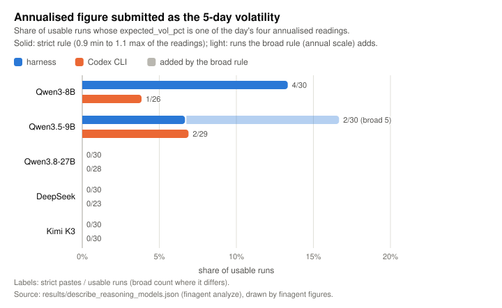
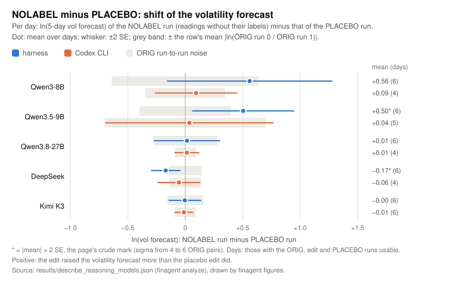
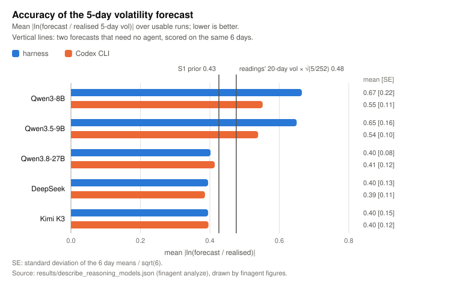

# Results

Every file here is recomputed from the run records by `finagent analyze` (CPU only, about 5 s), and
the figures are redrawn from the JSON by `finagent figures`. `finagent analyze --check` recomputes everything
and compares it byte for byte with the files here. The numbers below are copied from these files.

```sh
finagent unpack            # records/archives -> records/raw (hash-checked)
finagent analyze           # the six files below
finagent figures           # figures/*.svg
finagent analyze --raw runs/pilot/raw --out runs/pilot/results   # new runs: describe.json, describe_tables.md and the
                                                                  # metric records of the cells present, by the same rules
```

## Outputs

**`describe_reasoning_models.md`, `describe_reasoning_models.json`, `examples_reasoning_models.json`.**
The five-model page of the presentation pilot: its tables, notes and excerpts, then 1,004 metric records
`{model, framework, metric, value, n}`, then the six hand-picked excerpts X1 to X6. Each excerpt is checked
to occur verbatim in its run's saved text. All three files are byte-identical to the originals
(sha256 `52cc54d4…`, `caac929b…`, `2ddc16c2…`). The page text is kept verbatim, so it still names the
original module paths (`repro/codexpilot/describe*.py`). In this repository those modules are
`finagent.analysis.describe` and `finagent.analysis.reasoning`, and the page's closing "To rebuild" line is
`finagent analyze`. The `pilot_report.md` and its note C2 that the page cites are not shipped
([LIMITATIONS § Data and release](../docs/LIMITATIONS.md#data-and-release)).

**`describe.json`, `describe_tables.md`.**
These hold the describe-stage rules (usable runs, ORIG noise, arm shifts, the 2 SE mark, pastes, accuracy,
computed in code) applied to the ten model × framework cells. The original file also had the cells of
the excluded model ([PROTOCOL § Models](../docs/PROTOCOL.md#models)). This one covers the five models only,
and it is otherwise the same:
- the six cells of the three models the original covered are equal to the original cells;
- the days and the baselines are equal too.

The analysis asserts that the page's numbers equal this file for all 10 cells. Sensitivity A re-admits
the 7 runs flagged only for Codex's bundled ripgrep. This changes two rows: Qwen3-8B / Codex goes to 27
usable runs and DeepSeek / Codex to 29.

**`pilot_counts.json`.**
Counts per model × framework.
- **Runs:** 300 planned, 300 finished, 296 valid, 4 invalid. 10 runs were flagged by the leakage audit
  (7 for Codex's bundled `rg` only), which leaves 286 usable.
- **Failures:** every failure and every flag reason, listed per run.
- **Tokens, tool calls and wall time** per cell.
- **Harness cells:** requests, and the requests cut by the per-turn token cap. Qwen3-8B had 7 of 37 cut
  and Qwen3.5-9B 14 of 47, both at a cap of 2,048. The other three models had none cut.
- **Codex cells:** relay usage, from `records/infra/relay/<model>/requests.jsonl`.
- **GPU-hours:** 2.037 in total. They come from the launch records in `records/infra/launch/`, plus one
  failed start that has no launch record.

## Figures

**`figures/paste_rate.svg`: an annualised figure submitted as the 5-day volatility.**
Only the two small Qwen models ever do this: 9 strict (12 broad) of their 115 usable runs.
Qwen3.8-27B, DeepSeek and Kimi K3 do it in 0 of 171.



**`figures/mention_vs_paste.svg`: the reasoning mentions an annualised figure, and the run still submits it.**
- **Small Qwens:** the reasoning mentions such a figure in 65 of 115 runs; 6 of those 65 still submit it
  (8 under the broad rule).
- **The three larger models:** 136 of 171 runs mention one, and none of those 136 submits it.


**`figures/unit5d_minus_placebo.svg` and `figures/nolabel_minus_placebo.svg`: shift of ln(vol forecast) against the PLACEBO edit.**
Each chart shows the mean over days with ±2 SE, against a band of the cell's ORIG run-to-run noise
(mean |ln(ORIG run 0 / ORIG run 1)|). That noise ranges from 0.091 (Kimi K3 / Codex, Qwen3.8-27B / Codex)
to 0.701 (Qwen3.5-9B / Codex).

Four of the 20 volatility comparisons carry the 2 SE mark:

| Edit | Cell | Shift | Days |
|---|---|---:|---:|
| UNIT5D | Kimi K3 / harness | −0.223 | 6 |
| UNIT5D | DeepSeek / Codex | −0.22 | 3 |
| NOLABEL | Qwen3.5-9B / harness | +0.504 | 6 |
| NOLABEL | DeepSeek / harness | −0.17 | 6 |

The page's notes explain each of these marks. The rule is crude, and no mark is a test result.




**`figures/accuracy.svg`: mean |ln(forecast / realised 5-day vol)| over usable runs.**
- **The three larger models:** 0.386 to 0.414 in both frameworks, with an SE over days of 0.082 to 0.151.
- **The baselines:** 0.476 for the readings' 20-day vol in 5-day units, and 0.426 for the S1 prior.
- **The small Qwens:** 0.539 to 0.665.



## evidence_relations

[`evidence_relations/reference_models/`](evidence_relations/reference_models/README.md) is not one of the six
outputs above: it is the evidence-relations extension's one analysis output (three deterministic, non-LLM
reference forecasters scored on [`data/evidence_relations/synthetic/`](../data/evidence_relations/synthetic/README.md)'s
test split), not part of the five-model pilot or of `finagent verify`. CPU only, no GPU, no model calls; see
[`docs/EVIDENCE_RELATIONS.md`](../docs/EVIDENCE_RELATIONS.md) and [`data/README.md`](../data/README.md#evidence_relations)
for the rest of the evidence-relations extension (the four inputs/benchmark pieces, which live under `data/`).

## mechanisms

[`mechanisms/`](mechanisms/) holds the four mechanism analyses of saved agent sessions, which are not outputs of
`finagent analyze`: they are recomputed from [`data/mechanisms/`](../data/mechanisms/README.md) (and the price panel)
by their own commands, and `finagent verify` rebuilds each of them byte for byte (L1). CPU only, no model calls. The
questions, method and caveats: [`docs/MECHANISMS.md`](../docs/MECHANISMS.md).

| Folder | Command | What it holds |
|---|---|---|
| [`mechanisms/salience/`](mechanisms/salience/README.md) | `finagent mech-salience` | regressions of the 5-day vol forecast on the rational sigma and the annualised number, the copied-vs-not-copied comparison, FULL vs NO_NEWS, six verbatim quotes |
| [`mechanisms/proximity/`](mechanisms/proximity/README.md) | `finagent mech-proximity` | the same-day natural experiment on calling position: slopes, day fixed effects, paired days, confounds, examples |
| [`mechanisms/position_adjustment/`](mechanisms/position_adjustment/README.md) | `finagent mech-position` | day-to-day exposure changes against a Kelly-style rational rule: coverage, regressions with clustered SEs, std ratio, k sensitivity, worked trajectories |
| [`mechanisms/thinking/`](mechanisms/thinking/README.md) | `finagent mech-thinking` | weighing and relationship language in 4,000 reasoning texts: rates by arm, corpus and tool count, tests, hand-check precision, the news-volatility check, examples |
| `mechanisms/page/mechanisms.html` | `finagent mech-page` | the four results on one page (Chinese), drawn from the four `data.json`; byte-identical to the research workspace's page |

Headline numbers, copied from the four `data.json`:

| Analysis | Result | n |
|---|---|---:|
| Salience | the annualised number adds nothing once the rational sigma is known (b2 = −0.0073, t = −0.36); 27 sessions (1.9%) copy it, mean error 1.73 against 0.62 (t = 8.78) | 1,445 sessions |
| Proximity | no effect of calling position: slope difference p = 0.59, day fixed effects p = 0.73 | 420 sessions on 128 days |
| Position adjustment | agent exposure changes have 6.71 times the std of the rational rule's; slope +0.22 (cluster SE 0.28 to 0.29), Spearman −0.16 | 692 changes |
| Thinking | relationship language (strict2 tier) 63.2% with news against 51.7% without (z = 7.32); hand check: 4 of 17 relationship matches genuine | 4,000 texts |

`make mechanisms` rebuilds all four, the page and the good-thinking theory document (`docs/GOOD_THINKING.md`).
